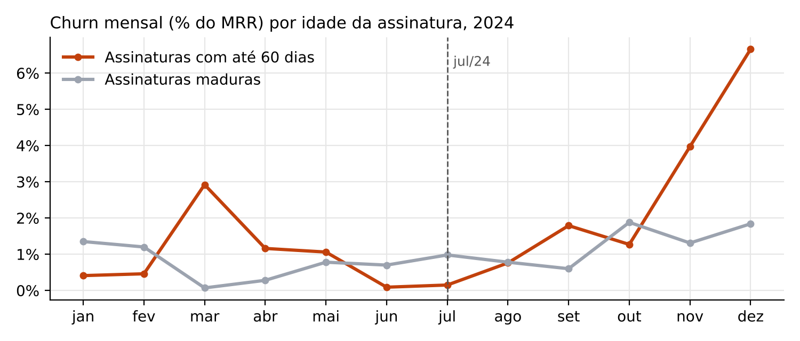
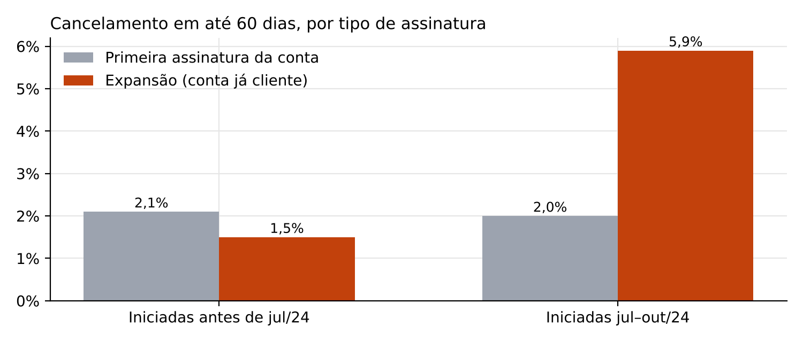

# Submissão — Heitor Cauchioli — Challenge 001

## Sobre mim

- **Nome:** Heitor Cauchioli
- **LinkedIn:** [linkedin.com/in/heitor-cauchioli](https://www.linkedin.com/in/heitor-cauchioli)
- **Challenge escolhido:** 001 — Diagnóstico de Churn

---

## Executive Summary

A RavenStack não está perdendo clientes antigos. Está perdendo as **assinaturas de expansão recém-vendidas**, que cancelam nos primeiros 60 dias.

- **O tamanho do problema:** no 4º tri/24 o MRR cancelado chegou a **$872K**, 5,9× o trimestre anterior. Desse valor, 66% veio de assinaturas com até 60 dias de vida e 81% veio do plano Enterprise.
- **Por que os times não viram:** o CSAT não registra notas abaixo de 3, e 68% dos cancelamentos acontecem sem nenhum ticket. O "uso cresceu" no total, mas o uso por assento caiu 57%.
- **A recomendação principal:** um programa obrigatório de "primeiros 60 dias" para toda expansão, com ~$1,1M de ARR preservado por semestre se o excesso de churn cair pela metade. Junto dele, mudar a comissão de expansão e provar a causa com um teste controlado.

---

## Solução

Arquivos principais:

- **Relatório:** [`solution/relatorio_diagnostico_churn.pdf`](solution/relatorio_diagnostico_churn.pdf), também em [Markdown](solution/relatorio_diagnostico_churn.md).
- **Código:** [`solution/codigo/`](solution/codigo/).

### Abordagem

1. **Validar os dados antes de analisar.** As três definições de churn não batem entre si (110, 352 e 312 contas). Além disso, 53% do uso e 54% dos tickets têm data anterior ao cadastro da conta. Por isso a análise usa a tabela de assinaturas (datas consistentes) e mede churn em MRR.
2. **Separar volume de taxa.** A base cresceu 4× em 2024, então o churn foi medido como taxa sobre a base ativa, não em contagem.
3. **Testar as afirmações de cada time.** Para "a satisfação está ok" e "o uso cresceu", cruzei tickets, CSAT e uso com os cancelamentos.
4. **Procurar o segmento.** Testei 23 atributos de conta (plano, indústria, canal, país, uso, tickets e outros). Nenhum diferenciou quem sai. O que diferenciou foi a **idade da assinatura** e o fato de ser **expansão**.
5. **Testar se dá para prever.** Usei um modelo de ML com corte temporal e uma regra simples de risco por fase de vida, validada com backtest.

### Resultados / Findings

| Achado | Número |
|---|---|
| MRR cancelado no 4º tri/24 | $872K (Q3: $147K) |
| Churn mensal (MRR), assinaturas com até 60 dias, 2º sem/24 | 3,13%, contra 1,32% das maduras |
| Cancelamento em 60 dias, expansões jul–out/24 | 5,9% (antes de jul/24: 1,5%; p < 0,001) |
| Cancelamento em 60 dias, primeira assinatura da conta | 2,0%, sem mudança |
| Uso por assento ativo, 1º→4º tri/24 | −57% (assentos +354%, uso +94%) |
| Respostas de CSAT com nota 1 ou 2 | 0 de 1.175 |
| Cancelamentos sem ticket nos 90 dias anteriores | 68% |
| Motivo de saída coerente com o comentário do cliente | 34% |
| AUC do modelo de ML (22 variáveis) | 0,52–0,54 (equivale a sorteio) |
| Backtest da regra por fase de vida | P1 perdeu 7,8% do MRR, contra 1,9% das P3 |





**Automação para o CS:** [`solution/codigo/watchlist.py`](solution/codigo/watchlist.py) gera diariamente a lista [`watchlist_contas.csv`](solution/codigo/watchlist_contas.csv). Ela traz prioridade P1/P2/P3 e ação sugerida por conta: são 76 contas P1, com $1,97M de MRR na janela de risco.

### Recomendações

1. **Programa "primeiros 60 dias"** para toda assinatura de expansão: kickoff em até 7 dias e checagem de adoção nos dias 14 e 30. As P1 recebem ligação do CSM em 48h.
    - Dono: CS. Impacto: ≈ $1,1M de ARR por semestre.
2. **Comissão de expansão paga após 90 dias ativos**, e venda de novos assentos condicionada a uso mínimo dos atuais.
    - Dono: Vendas.
3. **Teste controlado:** 20% das novas expansões fora do programa por 8 semanas, para provar a causa antes de escalar.
4. **Consertar as métricas:** CSAT de 1 a 5 também no cancelamento, motivo de saída único e obrigatório, correção das datas e uma definição oficial de churn em MRR.
5. **Não fazer agora:** desconto ou revisão de preço, comprar ferramenta de ML ou agir por indústria. Os dados não sustentam nenhum dos três.

### Limitações

- **Causa não provada:** a hipótese de assentos vendidos sem uso (*shelfware*) com onboarding insuficiente explica os dados, mas não está provada. Os dados não registram vendedor, desconto nem se houve onboarding.
- **Possível artefato em dezembro:** há um acúmulo de cancelamentos em 29–31/12/24 que pode vir do fim da extração. A conclusão se mantém sem dezembro.
- **Estimativa conservadora:** a regra de risco ordena bem as contas, mas subestimou o valor total perdido no backtest ($226K previstos contra $552K reais). Ela recalibra a cada execução.
- **Dados descartados:** metade dos registros de uso e de tickets tem datas inválidas e foi excluída das análises temporais.

---

## Process Log — Como usei IA

Narrativa completa: [`process-log/process_log.pdf`](process-log/process_log.pdf), também em [Markdown](process-log/process_log.md).

### Ferramentas

| Ferramenta | Para que usei |
|---|---|
| Claude (Opus 5.5, claude.ai) com execução de código | Toda a análise em Python (pandas, scipy, scikit-learn), o modelo, a automação, os gráficos e o relatório |

### Workflow

1. Escrevi um briefing com o desafio inteiro: papel, a contradição do CEO, as 3 perguntas, os critérios de qualidade, as dicas e os 5 CSVs.
2. O Claude validou os dados e encontrou os problemas de datas e as definições de churn conflitantes.
3. Recalculou o churn como taxa sobre a base e em MRR.
4. Testou 23 atributos de conta e não encontrou diferença significativa.
5. Mudou o eixo para a idade da assinatura e encontrou a piora concentrada nos primeiros 60 dias.
6. Separou primeira assinatura de expansão e localizou o problema nas expansões.
7. Testou as afirmações de CS (CSAT, tickets) e de Produto (uso por assento).
8. Treinou modelos de ML com corte temporal (AUC ≈ 0,5) e assumiu isso como achado.
9. Construiu e validou por backtest a regra de risco por fase de vida e o script da watchlist.
10. Gerou o relatório, o painel e este pacote de submissão.

### Onde a IA errou e como foi corrigido

Todos estes erros foram detectados e corrigidos pela própria IA durante a execução:

| Erro | Correção |
|---|---|
| Primeiro cálculo mostrou o uso por conta despencando desde 2023 | Detectou que 53% dos registros eram anteriores ao cadastro da conta e refez a análise só com dados válidos |
| Taxa trimestral inflada (11,7%) por misturar assinaturas criadas e canceladas no mesmo trimestre | Restringiu ao denominador da base existente (4,2%) |
| Variável que parecia preditiva no treino se inverteu no teste (AUC 0,43) | Abandonou o modelo por conta e passou a modelar por assinatura |
| Erros de código (caminho de arquivo, join, `np.select`) | Corrigidos e scripts reexecutados |

### O que eu adicionei que a IA sozinha não faria

- **O enquadramento do problema.** Tratei a contradição entre CEO, CS e Produto como hipótese a testar, não como contexto.
- **Os critérios do briefing.** Pedi para ponderar por MRR, checar o uso por segmento e separar correlação de causa. Cada um desses pedidos levou a um achado central.
- **O público-alvo.** Defini que o resultado tinha que ser acionável por um CEO não técnico, o que moldou o formato do relatório e das ações.

---

## Evidências

- [ ] Screenshots das conversas: `process-log/screenshots/`
- [ ] Export da conversa com o Claude: `process-log/chat-exports/`
- [x] Narrativa do processo: `process-log/process_log.pdf`
- [x] Código reproduzível: `solution/codigo/`, com setup abaixo
- [ ] Git history

### Setup do código

Requer Python 3.10 ou superior. Os 5 CSVs do desafio já estão em `solution/codigo/`.

```bash
pip install pandas numpy scipy scikit-learn
cd solution/codigo
python3 analise_diagnostico.py     # recalcula todos os números do relatório
python3 modelo_ml_teste.py         # reproduz o teste dos modelos de ML (AUC)
python3 watchlist.py . 2024-12-31  # gera a lista de contas para o CS
```

---

_Submissão enviada em: 22/10/2026_
