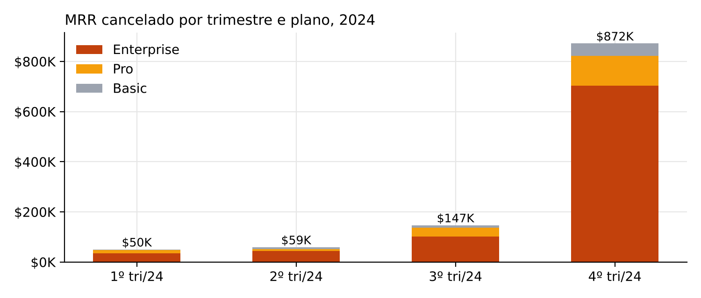
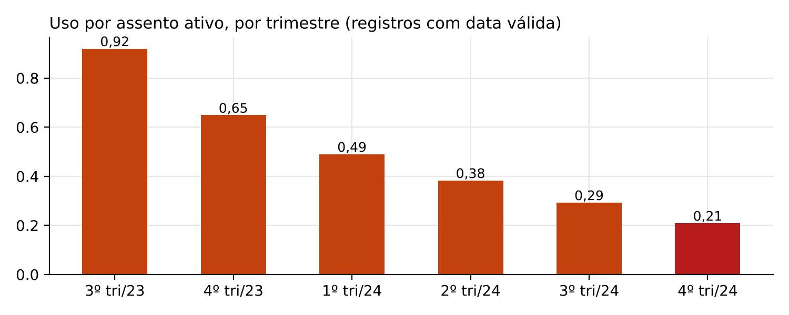

# Resumo para o CEO

**A RavenStack não está perdendo clientes antigos. Está perdendo as assinaturas de expansão recém-vendidas, que cancelam em semanas.**

| Indicador | Valor |
|---|---|
| MRR cancelado no 4º tri/24 | **$872K** (5,9× o 3º tri, que foi $147K) |
| Parte desse MRR vinda de assinaturas com até 60 dias | **66%** |
| Parte vinda do plano Enterprise | **81%** |
| Vida mediana das assinaturas canceladas no 4º tri | **27,5 dias** |
| Churn mensal (MRR) das assinaturas com até 60 dias, 2º sem/24 | **3,13%**, contra 1,32% das maduras |
| MRR perdido acima do normal no 2º sem/24 | **$179K** (≈ $2,1M de ARR) |

As três respostas pedidas:

1. **Causa raiz:** a venda de expansões acelerou, a adoção não acompanhou (uso por assento −57% em 2024) e essas assinaturas novas passaram a cancelar nos primeiros 60 dias. O primeiro contrato de cada conta não piorou.
2. **Segmento em risco:** não é uma indústria nem um plano. É uma **fase de vida**: toda expansão nos primeiros 60 dias. Em dinheiro, o risco está no Enterprise. Há **76 contas P1** com $1,97M de MRR nessa janela, listadas em `watchlist_contas.csv`.
3. **O que fazer:**
   - Programa "primeiros 60 dias" para toda expansão: cerca de **$1,1M de ARR preservado por semestre** se o excesso de churn cair pela metade.
   - Mudar a comissão de expansão.
   - Provar a causa com um teste controlado.
   - Consertar as métricas de CS e de saída.
   - **Não** mexer em preço.

# 1. O que está causando o churn

## 1.1 Primeiro, o número precisa de contexto

A base de assinaturas cresceu muito em 2024: as novas assinaturas foram de 472 no 1º tri para 2.069 no 4º. Boa parte do "churn subiu" é volume. Mesmo descontando o volume, sobra uma piora real no 4º trimestre.

| Trimestre | Novas assinaturas | Canceladas (todas) | MRR cancelado | Taxa da base* | Taxa em MRR* |
|---|---:|---:|---:|---:|---:|
| 1º tri/24 | 472 | 27 | $50.138 | 2,9% | 2,0% |
| 2º tri/24 | 686 | 37 | $59.026 | 2,8% | 2,3% |
| 3º tri/24 | 1.107 | 80 | $146.668 | 2,9% | 2,1% |
| 4º tri/24 | 2.069 | 324 | $871.812 | **4,2%** | **5,1%** |

\*Assinaturas ativas no início do trimestre que cancelaram até o fim dele.

## 1.2 A piora tem endereço: os primeiros 60 dias

Separando as assinaturas pela idade, as maduras (mais de 60 dias) ficaram estáveis o ano todo. As novas andavam juntas com elas até junho e descolaram a partir de julho.

| Período | Churn mensal (MRR), até 60 dias | Churn mensal (MRR), maduras |
|---|---:|---:|
| 1º sem/24 | 0,97% | 0,67% |
| jul–nov/24 | 1,87% | 1,17% |
| dez/24 | 6,66% | 1,84% |

## 1.3 É a expansão, não o cliente novo

| Assinaturas iniciadas | Tipo | Quantidade | Canceladas em 60 dias | Taxa |
|---|---|---:|---:|---:|
| Antes de jul/24 | Primeira da conta | 337 | 7 | 2,1% |
| Antes de jul/24 | Expansão | 1.487 | 23 | 1,5% |
| Jul–out/24 | Primeira da conta | 102 | 2 | 2,0% |
| Jul–out/24 | Expansão | 1.509 | 89 | **5,9%** |

- **Expansões depois de julho contra expansões antes:** teste exato de Fisher, p < 0,001.
- **Peso das expansões:** 94% das novas assinaturas de jul–out/24 foram expansões em contas que já eram clientes.
- **Vale para todos os segmentos:** a piora aparece em todos os planos, indústrias, canais, tipos de cobrança e renovação. Nenhuma dessas dimensões diferencia o cancelamento precoce (p entre 0,22 e 1,0).

## 1.4 O peso em dinheiro está no Enterprise

O salto do 4º trimestre é quase todo Enterprise: $704K dos $872K. Poucas assinaturas caras explicam a perda.

## 1.5 A cadeia causal que os dados sustentam

1. **A venda de expansões acelerou.** As novas assinaturas foram de 472 para 2.069 por trimestre, e 94% delas são expansões.
2. **A adoção não acompanhou.** Em 2024, os assentos ativos cresceram 354% e o uso total só 94%, então o uso por assento caiu 57%.
3. **As expansões passaram a morrer cedo.** O cancelamento em 60 dias foi de 1,5% para 5,9%, e a vida mediana caiu para menos de um mês.
4. **O valor está no Enterprise.** O plano concentra 81% do MRR perdido.

### Correlação ou causa?

**Provado nos dados:**

- O aumento está concentrado nos primeiros 60 dias.
- É específico das expansões.
- Aparece em todos os segmentos, então não é um segmento ruim.
- Coincide no tempo com a aceleração das expansões e com a queda do uso por assento.

**Hipótese, ainda não provada:** a causa seria vender assentos que o cliente não estava pronto para usar (*shelfware*), com um onboarding que não escalou junto com o volume. Os dados não registram quem vendeu, com qual desconto, nem se houve onboarding. A ação 3 testa essa hipótese em 8 semanas.

**Descartado:**

- **Preço:** plano, cobrança mensal ou anual e renovação automática têm a mesma taxa de churn.
- **Tempo de resposta do suporte:** ficou estável em cerca de 88 minutos.
- **Erros e features beta:** sem diferença entre quem sai e quem fica.

# 2. Por que CS e Produto não viram

## "A satisfação está ok" (CS)

- **A pesquisa não registra insatisfação:** das 1.175 respostas de CSAT, nenhuma é nota 1 ou 2. Só existem notas 3, 4 e 5.
- **Muitos não respondem:** 41% dos tickets ficam sem resposta.
- **Não diferencia quem sai:** contas que cancelaram têm o mesmo CSAT das que ficaram (3,98 contra 3,98).
- **O churn é silencioso:** 68% dos cancelamentos não tiveram nenhum ticket nos 90 dias anteriores. Nos cancelamentos precoces, 88% nunca falaram com o suporte.

Um CS que só reage a ticket nunca vai ver esse churn.

## "O uso cresceu" (Produto)

É verdade no total e falso por cliente. Em 2024, o uso cresceu 94%, mas os assentos vendidos cresceram 354%. A queda do uso por assento é igual em todos os planos e indústrias.

## "Os clientes saem por preço" (pesquisa de saída)

- **O motivo contradiz o comentário:** o motivo marcado bate com o comentário do próprio cliente em só 34% dos casos. Por exemplo, motivo "pricing" com comentário "faltam features".
- **Faltam respostas:** 37% das saídas não têm motivo ou comentário.
- **Os motivos não discriminam nada:** os seis motivos aparecem quase na mesma proporção, e o cruzamento entre motivo e comentário é aleatório (p = 0,99).

# 3. Segmentos e contas em risco

## 3.1 Nenhum atributo de conta passa no teste estatístico

| Dimensão | Maior churn de contas | Menor | p-valor |
|---|---|---|---:|
| Indústria | DevTools 31,0% | Cybersecurity 16,0% | 0,066 |
| Canal de aquisição | Evento 30,2% | Parceiro 14,6% | 0,079 |
| País | DE 32,0% (n=25) | AU 12,5% (n=32) | 0,659 |
| Plano | Enterprise 22,1% | Pro 21,9% | 0,999 |

DevTools e contas vindas de eventos estão perto do limite estatístico. Vale acompanhar, mas ainda não vale mudar a estratégia por eles.

## 3.2 O segmento de risco é uma fase de vida

Em 31/12/24 havia **$3,36M de MRR** em assinaturas com até 60 dias, de um MRR ativo total de $10,16M. A lista `watchlist_contas.csv` prioriza as 500 contas:

| Prioridade | Contas | MRR ativo | MRR na janela de 60 dias | Ação |
|---|---:|---:|---:|---|
| P1 | 76 | $2,73M | $1,97M | Ligação do CSM em 48h + plano de adoção |
| P2 | 303 | $5,52M | $1,39M | Onboarding automatizado + checagem no dia 30 |
| P3 | 121 | $1,92M | — | Rotina normal |

As 10 contas com maior perda esperada em 90 dias:

| Conta | Indústria | Plano | Prioridade | MRR ativo | MRR na janela | Perda esperada 90d |
|---|---|---|---|---:|---:|---:|
| Company_403 | FinTech | Basic | P1 | $114.777 | $60.255 | $4.424 |
| Company_166 | DevTools | Pro | P2 | $131.911 | $3.577 | $4.408 |
| Company_130 | EdTech | Basic | P1 | $83.886 | $59.055 | $3.388 |
| Company_368 | EdTech | Pro | P1 | $94.710 | $20.895 | $3.354 |
| Company_488 | EdTech | Basic | P1 | $75.776 | $75.776 | $3.291 |
| Company_337 | Cybersecurity | Basic | P1 | $70.644 | $47.415 | $2.829 |
| Company_341 | FinTech | Enterprise | P1 | $70.000 | $40.810 | $2.740 |
| Company_480 | EdTech | Enterprise | P1 | $70.980 | $27.860 | $2.639 |
| Company_23 | EdTech | Basic | P3 | $75.938 | — | $2.517 |
| Company_475 | FinTech | Pro | P1 | $67.737 | $21.172 | $2.463 |

# 4. O que fazer, em ordem de prioridade

| # | Ação | Dono | Prazo | Impacto estimado | Métrica de sucesso |
|---|---|---|---|---|---|
| 1 | **Programa "primeiros 60 dias"** para toda expansão: dono no CS desde o dia 1, kickoff em 7 dias, checagem de adoção nos dias 14 e 30, escalonamento se não houver uso no dia 14. Contas P1 recebem ligação na primeira semana. | Head de CS | Semana 1 | ≈ $1,1M de ARR preservado por semestre se o excesso cair pela metade | Churn mensal na janela voltando ao nível das maduras (≈ 1,3%) |
| 2 | **Regra comercial da expansão:** comissão paga só depois de 90 dias ativos, com estorno se cancelar antes; novos assentos só com uso mínimo dos assentos que a conta já tem. | CRO / Vendas | Próximo ciclo de comissão | Ataca a origem do mesmo excesso | Uso por assento 30 dias após a expansão |
| 3 | **Teste controlado:** 20% das novas expansões, sorteadas, ficam fora do programa por 8 semanas. | Dados + CS | 8 semanas | Confirma ou derruba a causa antes de escalar o investimento | Cancelamento em 60 dias: tratamento contra controle |
| 4 | **Consertar as métricas:** CSAT de 1 a 5 de verdade, aplicado também no cancelamento; motivo de saída único e obrigatório; corrigir as datas de uso e tickets; uma definição oficial de churn em MRR. | Dados / Eng. | 2–4 semanas | Pré-requisito para qualquer modelo futuro | % de saídas com motivo válido |
| 5 | **Não fazer agora:** desconto ou revisão de preço, compra de ferramenta de previsão de churn, ações por indústria. | — | — | Evita gastar com causas que os dados não sustentam | — |

**Como o impacto foi calculado:**

- **Excesso realizado:** no 2º sem/24, as assinaturas com até 60 dias perderam $309.556 de MRR. No ritmo das maduras (1,32% ao mês), teriam perdido $131.022. O excesso é de $178.534 de MRR, cerca de $2,14M de ARR.
- **Meta:** cortar esse excesso pela metade preserva cerca de $1,07M de ARR por semestre.
- **Sinal de alerta:** só em dezembro o excesso foi de $125K. Se o ritmo de dezembro continuar, o ganho potencial é maior.

# 5. Modelo preditivo e limites

## O modelo de machine learning não funcionou, e isso é um achado

Foram treinados dois modelos, regressão logística e gradient boosting, com 22 variáveis por conta: uso, erros, tickets, CSAT, escalonamentos, upgrades, downgrades, cobrança, indústria, canal, país e plano. O treino usou dados até 30/06/24 e o teste foi prever quem cancelaria no 4º tri. O AUC ficou em **0,52 e 0,54**, onde 0,50 é sorteio. Os sinais comportamentais disponíveis não antecipam o cancelamento.

## O que funcionou: risco pela fase de vida

A regra do `watchlist.py` calcula a perda esperada pela idade de cada assinatura. Ela foi testada como se estivéssemos em 30/09/24:

- **Ordenação:** as contas P1 perderam **7,8%** do MRR no 4º tri, contra **1,9%** das P3, cerca de 4× mais risco.
- **Limite:** ela subestimou o valor total ($226K previstos contra $552K reais), porque o churn acelerou em dezembro. O script recalibra as taxas a cada execução.

## Problemas nos dados

| Problema | Tamanho | Como foi tratado |
|---|---|---|
| Registros de uso com data anterior ao cadastro da conta | 53% | Excluídos das análises de tempo |
| Tickets com data anterior ao cadastro da conta | 54% | Excluídos das análises de tempo |
| Três definições de churn que não batem | 110, 352 e 312 contas; todas as 500 com assinatura ativa | Análise baseada na tabela de assinaturas, em MRR |
| Acúmulo de cancelamentos em 29–31/12/24 | 61 assinaturas | Conclusão verificada sem dezembro (jul–nov) |
| Motivo de saída incoerente com o comentário | 66% | Não usado como evidência |

# Anexo — como reproduzir

Os arquivos estão na pasta `codigo/`. Instruções de setup em `README.md`.

| Arquivo | O que faz |
|---|---|
| `analise_diagnostico.py` | Recalcula todos os números deste relatório e grava `out.json` |
| `modelo_ml_teste.py` | Treina os modelos de ML com corte temporal e imprime o AUC |
| `watchlist.py` | Gera a lista diária de contas priorizadas para o CS |
| `watchlist_contas.csv` | Lista em 31/12/24 (500 contas) |
